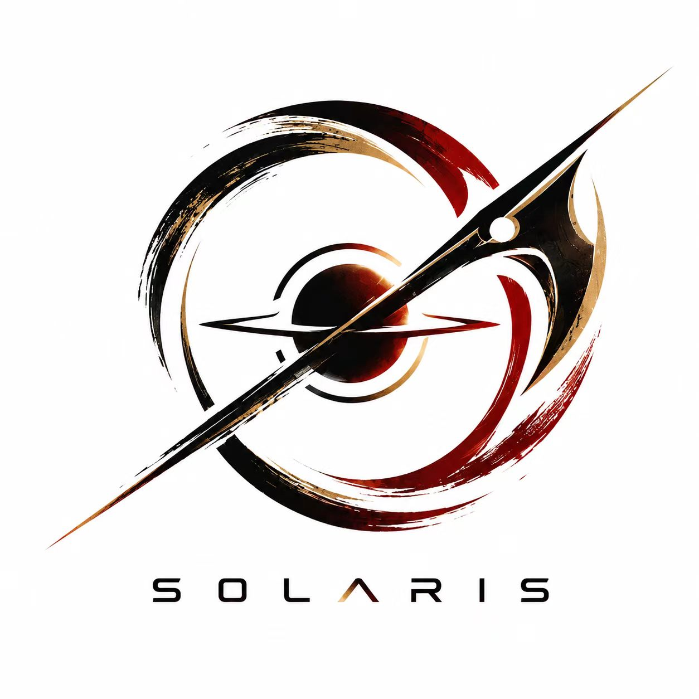

<div align="center">



# 天钺 Solaris · RoboMaster 技术博客

东南大学成贤学院（SEU-CXXY）天钺（Solaris）RoboMaster 战队的技术博客

**秣陵行胜，共赴千山。**

[在线访问](https://seu-cx-rm-solaris.github.io/solaris-blog-rm-seu-cxxy/) ·
[战队官网](https://seu-cx-rm-solaris.github.io/solaris-rm/) ·
[开源资源目录](https://seu-cx-rm-solaris.github.io/rm-open-source-leaderboard/)


</div>

---

## 内容板块

全部文章按系列分类，见[文章目录](https://seu-cx-rm-solaris.github.io/solaris-blog-rm-seu-cxxy/posts/)。

| 系列 | 篇数 | 说明 |
| --- | --- | --- |
| [同济大学招新培训笔记](https://seu-cx-rm-solaris.github.io/solaris-blog-rm-seu-cxxy/posts/tongji-rm25-training-overview/) | 5 | 整理自同济大学（SuperPower）战队公开的招新培训课件与视频，机械 / 电控 / 硬件 / 视觉四组 + 总索引，面向入队新生 |
| [步兵自瞄拆解](https://seu-cx-rm-solaris.github.io/solaris-blog-rm-seu-cxxy/posts/autoaim-00-overview/) | 31 | 基于同济 SuperPower `sp_vision_25` 开源项目的逐模块源码拆解：感知流水线、检测 / 分类 / 跟踪、整车 EKF、位姿解算、TinyMPC 轨迹规划、弹道模型、电控通信（CAN / 串口 / IMU）与配套学习笔记 |
| [STM32 电控入门](https://seu-cx-rm-solaris.github.io/solaris-blog-rm-seu-cxxy/posts/stm32-00-overview/) | 9 | 基于波特律动 STM32 学习套件 V3.2 的 26 个例程拆解：GPIO、UART、定时器与 PWM、ADC、I2C/SPI、FreeRTOS 入门教程与 HAL 速查 |

新文章会同步显示在博客首页的「最新文章」板块。

## 技术栈

- [Astro 7](https://astro.build/) 静态站点生成
- [Nayuta](https://github.com/yuanzui-cf/nayuta) 主题（MIT License）
- [Pagefind](https://pagefind.app/) 静态全文搜索（中文分词索引）
- 部署于 GitHub Pages（构建产物推送至 `gh-pages` 分支）

## 本地开发

需要 Node.js 22+。

```bash
npm install        # 安装依赖
npm run dev        # 开发服务器（默认 http://localhost:4321/solaris-blog-rm-seu-cxxy/）
npm run build      # 产出 dist/（自动完成 base 路径后处理）
npm run preview    # 预览生产构建
```

说明：

- 站点部署在 `https://seu-cx-rm-solaris.github.io/solaris-blog-rm-seu-cxxy/` 子路径下，
  `npm run build` 末尾会执行 `scripts/apply-base-path.mjs`，为构建产物中的内部链接统一添加 base 前缀。
- `pagefind` 固定使用 `1.5.2`：搜索索引与运行时需同版本，升级前请同步更新线上部署。

## 部署

GitHub Pages 采用 legacy 模式、从 `gh-pages` 分支部署：

```bash
npm run build
git worktree add ../blog-ghpages origin/gh-pages   # 挂出产物分支
# 用 dist/ 内容替换 ../blog-ghpages 下所有文件（保留 .nojekyll）
cd ../blog-ghpages && git add -A && git commit -m "Deploy" && git push origin HEAD:gh-pages
```

## 写作约定

- 文章放在 `src/content/posts/<slug>/index.md`，front-matter 需含
  `title`、`publishDate`、`description`、`category`（用于目录页分组）与 `tags`。
- 现有分组：`自瞄拆解 · 总索引 / 视觉 / 电控 / OpenCV / YOLO / ROS2 / 学习笔记`、
  `STM32 电控入门`、`同济大学招新培训笔记`。
- Markdown 中的表格依赖 GFM，仓库已强制 LF 换行（见 `.gitattributes`）。

## 版权与致谢

- 站点文章默认采用 [CC BY-NC-SA 4.0](https://creativecommons.org/licenses/by-nc-sa/4.0/deed.zh) 许可。
- 「同济大学招新培训笔记」整理自同济大学（SuperPower）战队公开课件与视频，版权归原作者及该战队所有；
  「STM32 电控入门」基于[波特律动](http://docs.keysking.com/docs/stm32/example/)公开学习套件整理，
  均仅作学习交流使用，若涉及版权问题请联系我们删除。
- 感谢 [Nayuta](https://github.com/yuanzui-cf/nayuta) 主题作者与开源社区。

## 联系我们

- 招新 QQ 群：`1103192008`
- 战队官网：<https://seu-cx-rm-solaris.github.io/solaris-rm/>
- GitHub 组织：<https://github.com/SEU-CX-RM-Solaris>
